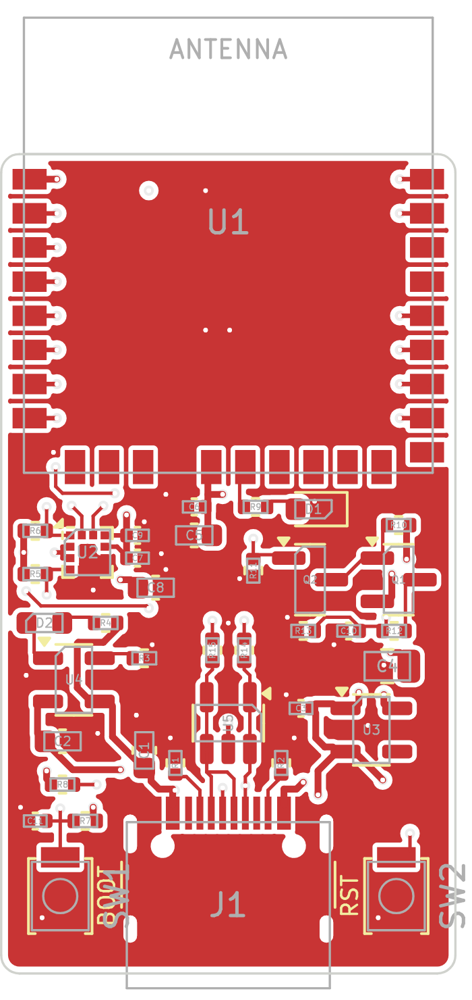

# Activity Badge — ESP32-H2 + LIS2DH12 + Zigbee

Thẻ đeo (wearable badge) giám sát mức độ hoạt động của công nhân trên công trình.
LIS2DH12 lấy mẫu gia tốc liên tục ở 1 Hz, ESP32-H2 tính `activity_score` mỗi phút và gửi về
Zigbee2MQTT với vai trò Zigbee Sleepy End Device, chạy bằng pin LiPo.

```
        USB-C 5 V                       3V3
   ┌──────────────┐   VBAT   ┌─────────┐      ┌──────────────────────┐   802.15.4
   │ MCP73831     ├────┬─────┤ RT9080  ├──┬───┤ ESP32-H2-WROOM-02C   │ ))) Zigbee ──► router ──► Zigbee2MQTT ──► MQTT
   │ sạc LiPo     │    │     │ LDO 3V3 │  │   │  GPIO4/5   I2C       │
   └──────────────┘  LiPo    └─────────┘  │   │  GPIO10    INT1 (đánh thức)
                    500 mAh               │   │  GPIO1/0   đo pin    │
                                          │   └──────────┬───────────┘
                                          │              │ I2C + INT1
                                          │   ┌──────────┴───────────┐
                                          └───┤ LIS2DH12             │  1 Hz, low-power, FIFO 32 mẫu
                                              └──────────────────────┘
```

## Thuật toán

```
a_mag = sqrt(ax² + ay² + az²)
a_dyn = |a_mag − 1 g|
sum_dyn += a_dyn ; sample_count += 1        (60 mẫu, lưu trong RTC memory)
activity_score = sum_dyn / sample_count     → gửi Zigbee → reset
```

## Nội dung repo

| Thư mục | Nội dung | Tài liệu |
|---|---|---|
| [`hardware/`](hardware/) | Project KiCad: schematic + **PCB 20 × 36 mm, 4 lớp, đã đi dây**, Gerber, BOM, toạ độ linh kiện | [hardware/README.md](hardware/README.md) |
| [`firmware/`](firmware/) | Project ESP-IDF cho ESP32-H2 (esp-zigbee-sdk 2.x) | [firmware/README.md](firmware/README.md) |
| [`zigbee2mqtt/`](zigbee2mqtt/) | External converter cho Zigbee2MQTT + test | [docs/zigbee2mqtt.md](docs/zigbee2mqtt.md) |
| [`docs/`](docs/) | Ước tính dòng tiêu thụ/pin, hướng dẫn join và kiểm thử | [docs/power.md](docs/power.md) |

## Bắt đầu nhanh

1. **Phần cứng**: mở `hardware/kicad/activity-badge.kicad_pro` bằng KiCad 7 trở lên (schematic và
   PCB). File sản xuất nằm ở `hardware/out/fab/`; đọc mục 9 của `hardware/README.md` trước khi đặt hàng.
2. **Firmware** (ESP-IDF v5.5 trở lên):

   ```bash
   cd firmware && idf.py set-target esp32h2 && idf.py build
   ```
   Nạp: giữ BOOT, nhấn RESET, thả BOOT, rồi `idf.py -p /dev/ttyACM0 flash`.
3. **Zigbee2MQTT**: chép `zigbee2mqtt/activity_badge.mjs` vào `external_converters/`, bật
   `advanced.enable_external_js`, bật Permit join, cấp nguồn cho badge.
4. Dữ liệu xuất hiện mỗi phút trên `zigbee2mqtt/<tên badge>`:

   ```json
   {"activity_score": 0.127, "battery": 86, "voltage": 4000, "linkquality": 120}
   ```

## Các quyết định thiết kế chính

| Quyết định | Lý do |
|---|---|
| Cảm biến lấy mẫu vào FIFO, MCU chỉ dậy 2 lần/phút theo ngắt watermark INT1 | MCU không phải dậy 60 lần/phút; LIS2DH12 chỉ tốn ~2 µA |
| INT1 nối vào GPIO10 | Chỉ GPIO7–14 (LP GPIO) đánh thức được ESP32-H2 khỏi deep sleep |
| `activity_score` gửi qua Analog Input (0x000C) PresentValue, pin qua Power Configuration (0x0001) | Cluster chuẩn, converter Z2M chỉ vài dòng |
| Firmware tự gửi Report Attributes tới coordinator | Không phụ thuộc binding/configure reporting, vốn dễ lỡ với thiết bị ngủ |
| Hai chế độ ngủ chọn bằng Kconfig: deep sleep (mặc định, theo đề bài) và light sleep | Ước tính light sleep cho thời lượng pin dài hơn ~4–5 lần ở chu kỳ 1 phút; xem [docs/power.md](docs/power.md) |
| LDO Iq 2 µA, mạch đo pin có công tắc, không thạch anh 32 kHz | Giảm dòng nền và BOM |
| PCB 20 × 36 mm, linh kiện một mặt, pin hàn dây ở mặt dưới, anten nhô khỏi mép board | Gọn (nằm trong diện tích cell 500 mAh), lắp ráp rẻ, anten không bị đồng và FR-4 che |

## Trạng thái kiểm chứng

| Hạng mục | Trạng thái |
|---|---|
| Firmware build (ESP-IDF v5.5.4, esp-zigbee-lib 2.1.0), cả deep sleep, light sleep và bản release | Đã build, không warning trong mã project |
| Thuật toán activity | Unit test trên PC (so với công thức số thực trên 200 000 mẫu ngẫu nhiên) |
| Converter Zigbee2MQTT | Chạy thử với zigbee-herdsman-converters 26.129.0 bằng báo cáo giả lập |
| Schematic KiCad | Netlist xuất từ KiCad được so khớp tự động với netlist thiết kế; ERC chưa chạy |
| PCB KiCad | DRC của KiCad: 0 lỗi, 0 net chưa nối; net của 155 pad khớp với schematic. Chưa có người rà soát layout |
| **Chạy trên phần cứng thật** | **Chưa.** Board chưa được chế tạo; hành vi Zigbee trên sóng, dòng tiêu thụ và hiệu năng anten chưa được kiểm tra |

Danh sách việc cần xác minh: mục 9 của [hardware/README.md](hardware/README.md) trước khi đặt PCB, và
mục 6 của [firmware/README.md](firmware/README.md) khi có board.


