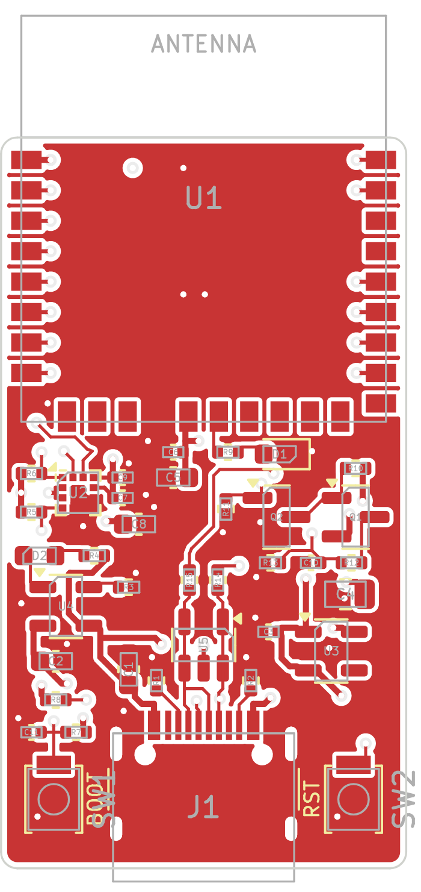
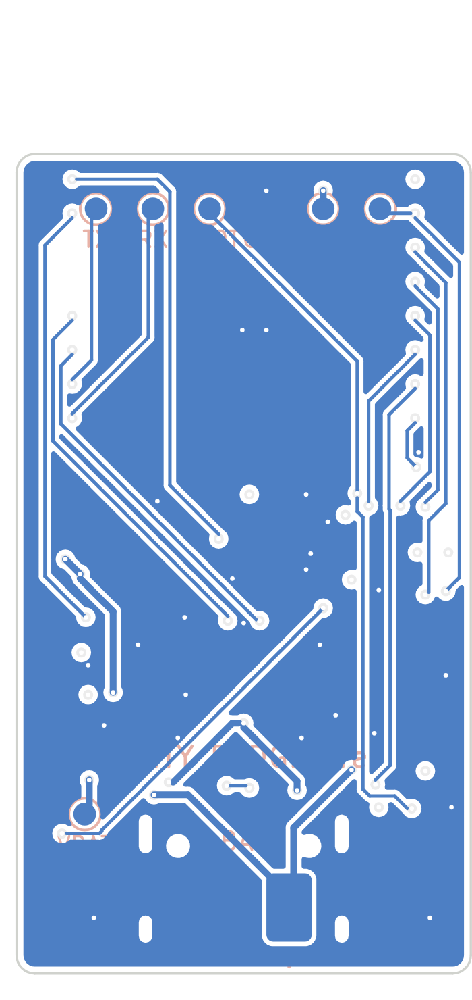

# Phần cứng — Activity Badge (ESP32-H2-WROOM-02C + LIS2DH12)

 

Board 20 × 36 mm, 4 lớp, linh kiện một mặt, cổng USB-C để sạc và nạp firmware. Anten của module nhô
6 mm ra ngoài mép trên, nên tổng chiều dài là 42 mm.

> **Trạng thái.** Schematic và PCB được sinh bằng script, PCB đã qua DRC của KiCad (0 lỗi, 0 net
> chưa nối) và khớp netlist với schematic. Thiết kế **chưa được chế tạo và chưa có kỹ sư layout rà
> soát**; xem mục 9 trước khi đặt hàng.

## 1. File trong thư mục này

| File | Nội dung |
|---|---|
| `kicad/activity-badge.kicad_pro`, `.kicad_sch`, `.kicad_pcb` | Project KiCad (định dạng KiCad 7, mở được bằng KiCad 7/8/9) |
| `kicad/badge.kicad_sym` | Symbol ESP32-H2-WROOM-02C (thư viện chuẩn của KiCad và của Espressif chưa có module này) |
| `kicad/badge.pretty/` | Footprint module (theo "Recommended PCB Land Pattern" của datasheet v1.2, có vùng cấm đồng dưới anten) và footprint pad hàn dây pin |
| `out/activity-badge.pdf` | Sơ đồ nguyên lý |
| `out/pcb-front.pdf`, `out/pcb-back.pdf`, `out/*.png` | Bản vẽ PCB mặt trên / mặt dưới |
| `out/activity-badge.net`, `out/bom.csv` | Netlist KiCad, BOM |
| `out/drc-report.txt` | Báo cáo DRC của KiCad cho PCB |
| `out/fab/activity-badge-gerbers.zip` | Gerber X2 (4 lớp đồng, mask, paste, silkscreen, outline) + file khoan Excellon |
| `out/fab/activity-badge-pos.csv` | Toạ độ linh kiện cho máy gắp đặt |
| `gen/gen_kicad.py` | Sinh schematic, symbol, footprint, BOM, netlist từ một danh sách linh kiện + net duy nhất, rồi tự kiểm tra |
| `gen/gen_pcb.py`, `gen/router.py` | Dựng PCB bằng API `pcbnew`: đặt linh kiện, đi dây, đổ đồng, chạy DRC |
| `gen/fab_outputs.py` | Xuất Gerber, file khoan, toạ độ linh kiện, bản vẽ PDF |

Sinh lại toàn bộ (cần KiCad ≥ 7; `gen_pcb.py` phải chạy bằng Python có module `pcbnew` của KiCad):

```bash
python3 hardware/gen/gen_kicad.py
```

```bash
/usr/bin/python3 hardware/gen/gen_pcb.py
```

```bash
python3 hardware/gen/fab_outputs.py
```

## 2. Cây nguồn

```
USB-C VBUS 5 V ──► MCP73831 (sạc 213 mA) ──► VBAT (LiPo 1S 3,0–4,2 V) ──► RT9080-3.3 (Iq 2 µA) ──► +3V3
                                                │                                      ├─ ESP32-H2-WROOM-02C
                                                └─ Q1/Q2 + chia áp 1:2 ─► ADC (GPIO1)  └─ LIS2DH12 (luôn cấp điện)
```

- **LDO thay vì buck**: hiệu suất LDO từ 3,8 V xuống 3,3 V đã ~87 %, và ở tải µA dòng tĩnh của bộ
  nguồn mới là yếu tố quyết định. RT9080 có Iq 2 µA và chịu được 600 mA (datasheet module yêu cầu
  nguồn cấp ≥ 350 mA).
- Khi pin xuống dưới ~3,4 V LDO vào vùng sụt áp, +3V3 bám theo VBAT; module làm việc tới 3,0 V.
- LIS2DH12 không được cắt nguồn: nó phải lấy mẫu liên tục trong lúc MCU ngủ.
- Cell LiPo phải là loại **có mạch bảo vệ (PCM)**.
- **Nối pin khi dùng và khi nạp firmware qua USB.** Board không có đường nguồn riêng từ VBUS tới
  LDO: khi chỉ cắm USB, mọi dòng tải đều đi qua IC sạc. Hành vi của MCP73831 khi không có pin (ngắt
  sạc rồi sạc lại liên tục) chưa được kiểm chứng trên board này.

## 3. Sơ đồ chân ESP32-H2-WROOM-02C

| Chân module | Tên | GPIO | Net | Nối tới | Ghi chú |
|---|---|---|---|---|---|
| 1 | 3V3 | — | +3V3 | mặt phẳng +3V3 (lớp trong 2) | |
| 2 | EN | — | EN | SW2 (RESET), TP6 | module đã có sẵn RC 10 kΩ/1 µF |
| 3 | IO4 | GPIO4 | I2C_SDA | LIS2DH12 chân 4, R5 4,7 kΩ lên +3V3 | |
| 4 | IO5 | GPIO5 | I2C_SCL | LIS2DH12 chân 1, R6 4,7 kΩ lên +3V3 | |
| 5 | IO10 | GPIO10 | ACC_INT1 | LIS2DH12 chân 12 | **LP GPIO**: đánh thức từ deep sleep |
| 6 | IO11 | GPIO11 | ACC_INT2 | LIS2DH12 chân 11 | LP GPIO, dự phòng (firmware chưa dùng) |
| 7 | IO8 | GPIO8 | IO8_STRAP | R8 10 kΩ lên +3V3 | strapping: phải ở mức cao để vào download mode |
| 8 | IO9 | GPIO9 | BOOT | SW1, R7 10 kΩ lên +3V3, C11 100 nF, TP7 | strapping BOOT + nút người dùng, LP GPIO |
| 9, 13, 29 | GND | — | GND | mặt phẳng GND (lớp trong 1) | 29 = pad tản nhiệt dưới module |
| 10 | IO12 | GPIO12 | — | không nối | LP GPIO còn trống |
| 11, 12 | IO13, IO14 | GPIO13/14 | — | không nối | chân XTAL 32 kHz, không dùng |
| 14 | VBAT | — | +3V3 | C6 100 nF + C5 10 µF ngay dưới chân | mặc định nối 3V3 bên trong module |
| 15 | IO22 | GPIO22 | LED_STATUS | R9 2,2 kΩ → D1 → GND | tích cực mức cao |
| 16–19 | NC | — | — | không nối | |
| 20 | IO25 | GPIO25 | — | không nối | strapping nguồn JTAG, bị bỏ qua với eFuse mặc định |
| 21 | RXD0 | GPIO23 | UART_RX | TP5 | console/nạp qua UART |
| 22 | TXD0 | GPIO24 | UART_TX | TP4 | console (115200) |
| 23 | IO26 | GPIO26 | USB_DN | R15 0 Ω → U5 → USB-C D− | USB-Serial-JTAG |
| 24 | IO27 | GPIO27 | USB_DP | R14 0 Ω → U5 → USB-C D+ | USB-Serial-JTAG |
| 25, 26 | IO3, IO2 | GPIO3/2 | — | không nối | còn trống (ADC1_CH2/CH1) |
| 27 | IO1 | GPIO1 | VBAT_SENSE | điểm giữa R12/R13, C10 10 nF | ADC1_CH0 |
| 28 | IO0 | GPIO0 | VBAT_SENSE_EN | cực G của Q2, R11 1 MΩ xuống GND | mức cao = bật mạch chia áp |

Sơ đồ chân này trùng với `firmware/main/board.h`; việc thiết kế PCB không đổi chân nào.

### Kết nối ESP32-H2-WROOM-02C ↔ LIS2DH12 (LGA-12)

| LIS2DH12 | Tên | Nối tới | Ghi chú |
|---|---|---|---|
| 1 | SCL/SPC | GPIO5 (module chân 4) | I2C 400 kHz, kéo lên 4,7 kΩ |
| 2 | CS | +3V3 | mức cao = chế độ I2C |
| 3 | SDO/SA0 | +3V3 | địa chỉ I2C 0x19 (nối GND thì là 0x18) |
| 4 | SDA/SDI/SDO | GPIO4 (module chân 3) | kéo lên 4,7 kΩ |
| 5 | Res | GND | |
| 6, 7, 8 | GND | GND | |
| 9 | VDD | +3V3 | C7 100 nF + C8 10 µF sát chân |
| 10 | VDD_IO | +3V3 | C9 100 nF sát chân |
| 11 | INT2 | GPIO11 (module chân 6) | dự phòng: ngắt chuyển động/rơi tự do |
| 12 | INT1 | GPIO10 (module chân 5) | ngắt watermark FIFO, tích cực mức cao, push-pull |

Vì sao chọn các chân này:

- **INT1/INT2 phải vào LP GPIO (GPIO7–14)** vì chỉ các chân này dùng được làm nguồn đánh thức EXT1
  khi deep sleep. GPIO8/9 là strapping, GPIO13/14 là chân thạch anh 32 kHz, nên còn GPIO10/11/12.
- I2C trên GPIO4/5: không phải strapping, nằm cạnh GPIO10/11 trên cùng một cạnh module. (GPIO2–5
  là chân JTAG ngoài, nhưng mặc định ESP32-H2 dùng JTAG qua USB nên các chân này tự do.)
- GPIO26/27 dành cho USB, GPIO23/24 cho UART0, GPIO0/1 cho đo pin (GPIO1 có ADC).

## 4. Các khối mạch

**USB-C + ESD.** J1 (USB 2.0, 16 chân). CC1, CC2 mỗi chân một điện trở 5,1 kΩ xuống GND để nguồn
USB-C cấp 5 V. D+/D− qua U5 USBLC6-2SC6 rồi R14/R15 (0 Ω, chỗ để chỉnh tín hiệu) tới GPIO27/26.
Cổng này vừa sạc vừa nạp firmware/JTAG qua USB-Serial-JTAG của ESP32-H2, không cần chip USB-UART.

**Sạc LiPo.** U4 MCP73831T-2ACI/OT, 4,20 V. R3 = 4,7 kΩ → dòng sạc 1000 V / 4,7 kΩ ≈ 213 mA (hợp
với cell ≥ 400 mAh; đổi R3 nếu dùng cell khác: 10 kΩ → 100 mA, 2 kΩ → 500 mA). D2 sáng khi đang sạc
(VBUS → R4 → D2 → STAT), lấy điện từ VBUS nên không hao pin.

**Pin.** J2 là hai pad hàn dây 2 × 3 mm ở **mặt dưới**, ngay dưới cổng USB-C, có in "+" và "−".
Chọn pad hàn thay cho đầu nối để board gọn hơn (đầu nối JST-PH chiếm khoảng 8 × 8 mm mặt trên) và
chắc hơn khi thẻ bị rung lắc; đổi lại, thay pin phải dùng mỏ hàn.

**LDO 3,3 V.** U3 RT9080-33GJ5, EN nối VBAT (luôn bật). C3 1 µF ở ngõ vào, C4 22 µF ở ngõ ra để đỡ
bước tải từ µA lên hàng chục mA khi radio bật.

**MCU.** U1 ESP32-H2-WROOM-02C-H4S (4 MB flash, anten PCB). R8 kéo GPIO8 lên, R7 kéo GPIO9 lên.

**Gia tốc kế.** U2 LIS2DH12TR, I2C địa chỉ 0x19.

**Đo pin có công tắc.** Q1 (P-MOSFET AO3401A) nối VBAT vào mạch chia R12/R13 (100 kΩ/100 kΩ, 1 %)
chỉ khi GPIO0 ở mức cao (qua Q2 2N7002 kéo cực G của Q1 xuống). Khi tắt, dòng tiêu thụ chỉ còn dòng
rò của MOSFET và chân ADC ở 0 V (không bao giờ vượt quá 3,3 V). C10 10 nF giữ điện áp cho ADC lấy
mẫu; hằng số thời gian 0,5 ms nên firmware chờ 5 ms rồi đo.

**Nút và LED.** SW1 = BOOT/người dùng (GPIO9): nhấn ngắn để thức và ghép nối, giữ 5 s để factory
reset, giữ khi nhấn RESET để vào download mode. SW2 = RESET (EN). Hai nút loại 3 × 2,5 mm (Omron
B3U-1000P) nằm hai bên cổng USB-C. D1 = LED trạng thái.

**Test pad.** 7 pad tròn 1 mm ở mặt dưới, có in tên: EN, 3V3, GND, BOOT, RX, TX (một hàng phía
trên) và VBAT (góc dưới): đủ để nạp và kiểm tra bằng đồ gá pogo-pin.

## 5. BOM

Bản đầy đủ theo từng mã tham chiếu: [`out/bom.csv`](out/bom.csv). Mã linh kiện của điện trở, tụ,
LED và nút nhấn trong file đó chỉ là gợi ý ("or equivalent"), chưa đối chiếu với nhà phân phối.

| Ref | Giá trị / mã linh kiện | Footprint KiCad | Ghi chú |
|---|---|---|---|
| U1 | ESP32-H2-WROOM-02C-H4S | `badge:ESP32-H2-WROOM-02C` | 18 × 20 × 3,2 mm |
| U2 | LIS2DH12TR | `Package_LGA:LGA-12_2x2mm_P0.5mm` | |
| U3 | RT9080-33GJ5 | `Package_TO_SOT_SMD:TSOT-23-5` | thay thế cùng chân: XC6220B331MR-G (Iq ~8 µA), TPS7A0533PDBVR (Iq 1 µA, 200 mA) |
| U4 | MCP73831T-2ACI/OT | `Package_TO_SOT_SMD:SOT-23-5` | |
| U5 | USBLC6-2SC6 | `Package_TO_SOT_SMD:SOT-23-6` | |
| Q1 | AO3401A | `Package_TO_SOT_SMD:SOT-23` | P-MOSFET |
| Q2 | 2N7002 | `Package_TO_SOT_SMD:SOT-23` | N-MOSFET (hoặc BSS138) |
| J1 | USB-C 16P, HRO TYPE-C-31-M-12 | `Connector_USB:USB_C_Receptacle_HRO_TYPE-C-31-M-12` | |
| J2 | pad hàn dây pin | `badge:BatteryPads_1x02_P4.0mm` | không có linh kiện |
| SW1, SW2 | Omron B3U-1000P | `Button_Switch_SMD:SW_SPST_B3U-1000P` | 3 × 2,5 mm |
| D1 | LED xanh lá 0603 | `LED_SMD:LED_0603_1608Metric` | trạng thái |
| D2 | LED cam 0603 | `LED_SMD:LED_0603_1608Metric` | đang sạc |
| R1, R2 | 5,1 kΩ | `Resistor_SMD:R_0402_1005Metric` | CC1, CC2 |
| R3 | 4,7 kΩ 1 % | 0402 | PROG: dòng sạc 213 mA |
| R4 | 1 kΩ | 0402 | LED sạc |
| R5, R6 | 4,7 kΩ | 0402 | kéo lên I2C |
| R7, R8 | 10 kΩ | 0402 | kéo lên GPIO9, GPIO8 |
| R9 | 2,2 kΩ | 0402 | LED trạng thái |
| R10, R11 | 1 MΩ | 0402 | phân cực Q1, Q2 |
| R12, R13 | 100 kΩ 1 % | 0402 | chia áp pin |
| R14, R15 | 0 Ω | 0402 | nối tiếp USB D+/D− |
| C1 | 10 µF 16 V X5R | `Capacitor_SMD:C_0603_1608Metric` | VBUS |
| C2, C5, C8 | 10 µF | 0603 | VBAT, module 3V3, VDD cảm biến |
| C3 | 1 µF | 0402 | ngõ vào LDO |
| C4 | 22 µF | `Capacitor_SMD:C_0805_2012Metric` | ngõ ra LDO |
| C6, C7, C9, C11 | 100 nF | `Capacitor_SMD:C_0402_1005Metric` | lọc nguồn module, VDD, VDD_IO; chống rung nút |
| C10 | 10 nF | 0402 | lọc ADC |
| TP1–TP7 | pad thử 1 mm | `TestPoint:TestPoint_Pad_D1.0mm` | mặt dưới, không có linh kiện |
| — | Cell LiPo 1S 400–600 mAh có PCM, dây hàn | — | ví dụ cỡ 502535 (25 × 35 mm), đặt dưới board |

## 6. PCB

| Thông số | Giá trị |
|---|---|
| Kích thước | 20 × 36 mm, bo góc R 0,8 mm, dày 1,6 mm |
| Lớp | 4: F.Cu linh kiện + tín hiệu / In1.Cu GND liền / In2.Cu +3V3 / B.Cu tín hiệu |
| Lắp ráp | Toàn bộ 38 linh kiện ở mặt trên; mặt dưới chỉ có pad pin và test pad |
| Luật thiết kế | Track/khe hở 0,15/0,15 mm; đường nguồn 0,3 mm; **via 0,6 mm, lỗ 0,3 mm**; cách mép 0,3 mm |
| Đồng | 228 đoạn track, 70 via (tất cả lỗ 0,3 mm); GND đổ trên cả lớp trên và lớp dưới |
| DRC KiCad | 0 lỗi, 0 net chưa nối (`out/drc-report.txt`) |

Bố trí:

```
        ┌──────────────────┐  ← anten của module nhô 6 mm ra ngoài mép trên (không có FR-4/đồng bên dưới)
   y=0  ├──────────────────┤
        │       U1         │  ESP32-H2-WROOM-02C; mặt dưới: hàng test pad EN 3V3 GND BOOT RX TX
  14,5  ├──────────────────┤
        │ U2 cảm biến  C5/C6  D1 │  trái: LIS2DH12 + kéo lên I2C     phải: mạch đo pin Q1/Q2
        │ U4 sạc     R14/R15  U3 │  trái: MCP73831                  phải: LDO RT9080 + C4
        │           U5 ESD       │
  28    │ SW1 [  USB-C J1  ] SW2 │  mặt dưới: pad pin "+" "−" dưới cổng USB-C
   36   └──────────────────┘
```

Cách đi dây:

- **Tín hiệu của module đi lớp dưới.** Mỗi chân cạnh module có một đoạn ngắn và một via ngay sát
  ("hàng rào via"); phía dưới thân module ở lớp trên chỉ còn đồng GND.
- **Hai mặt phẳng trong không bị cắt.** Mọi tín hiệu nằm ở lớp trên và lớp dưới; In1 là GND liền,
  In2 là +3V3. Mỗi chân GND/+3V3 có via riêng xuống mặt phẳng.
- **Tụ lọc của module** (C6, C5) nằm ngay dưới chân 13 (GND) và 14 (3V3), nối bằng hai đường thẳng 0,3 mm.
- **USB-C**: bốn pad D+/D− bước 0,5 mm được nối chéo ngay phía trên đầu nối (một via 0,6 mm cho
  D+, đường D− bên cạnh né sớm sang trái để đủ khe hở), đi qua U5 rồi R14/R15 tới chân 23/24 của
  module; đoạn dưới thân module nằm ở lớp dưới.
- **LIS2DH12**: không có track hay via dưới thân linh kiện; I2C đi thẳng sang điện trở kéo, INT1/INT2
  đi lên phía module.
- Các chỗ khó (USB-C, LIS2DH12, tụ lọc, hàng rào via) được **vẽ tay bằng toạ độ** trong
  `pre_routes()` của `gen_pcb.py`; phần còn lại do bộ đi dây lưới 0,05 mm trong `router.py` tự tìm
  (KiCad không có autorouter). Vì các đoạn vẽ tay gắn với toạ độ, khi dời linh kiện trong bảng
  `PLACE` phải sửa cả `pre_routes()`. Via vẽ tay nào bộ đi dây không cần tới sẽ được gỡ ở bước dọn cuối.

Board còn có thể ngắn hơn khoảng 2 mm nếu xếp dày hơn bằng tay, hoặc ngắn hơn nhiều (~20 × 26 mm)
nếu chấp nhận lắp linh kiện hai mặt. Với cell 500 mAh cỡ 25 × 35 mm đặt dưới board thì 20 × 36 mm
đã nằm gọn trong diện tích của pin.

### Đặt sản xuất

- PCB 4 lớp, FR-4 1,6 mm (1,0 mm cũng được nếu cần nhẹ hơn), đồng 1 oz ngoài / 0,5 oz trong.
- Năng lực cần có: track/khe hở 0,15 mm; via đường kính 0,6 mm, lỗ 0,3 mm (vành khuyên 0,15 mm).
  Lỗ nhỏ nhất trên board là 0,3 mm; các lỗ còn lại là 0,6 mm (chân vỏ USB-C) và 0,65 mm (chốt định
  vị USB-C, không mạ). Đây là mức tiêu chuẩn, thường không bị tính phụ phí.
- Upload `out/fab/activity-badge-gerbers.zip`. File toạ độ linh kiện dùng tên cột của KiCad
  (gốc ở góc trên trái, Y âm); nhà lắp ráp có thể yêu cầu đổi tên cột và kiểm tra lại góc xoay.
- Module U1 nhô ra ngoài mép board 6 mm: báo cho nhà lắp ráp và chừa khoảng trống ở mép đó khi ghép panel.

## 7. Nguyên tắc layout đã áp dụng

**Anten.** Phần anten của module nằm ngoài board nên không có FR-4 hay đồng bên dưới. Pin LiPo (vỏ
nhôm), vít và kẹp kim loại của thẻ không được nằm chồng lên vùng này: đặt pin lùi về phía cổng USB.
Thẻ đeo trên người bị cơ thể hấp thụ sóng 2,4 GHz, nên hướng mặt anten ra ngoài và đo vùng phủ khi
đang đeo thật. Vỏ hộp bằng nhựa, không sơn dẫn điện, không tem kim loại ở vùng anten.

**Nguồn và tụ lọc.** C6/C5 sát chân 13/14 của module; C4 sát ngõ ra LDO, C3 sát ngõ vào; C1, C2
sát chân VDD và VBAT của MCP73831; C7/C8 và C9 sát chân 9 và 10 của LIS2DH12.

**Mặt phẳng GND.** Lớp trong 1 là GND liền dưới toàn bộ mạch. Pad tản nhiệt của module có 2 via
GND; có thể thêm via khâu GND ở các khoảng trống nếu muốn.

**LIS2DH12.** Đặt cách mép board gần 3 mm, xa nút nhấn và đầu nối USB (ứng suất cơ học làm lệch
offset), xa IC sạc và LDO (nhiệt làm trôi offset). Hàn bằng reflow, không hàn tay bằng mỏ hàn.

**Cơ khí và môi trường công trường.** Cố định pin bằng băng keo xốp và giữ dây pin để mối hàn không
chịu lực. Bụi, mồ hôi, mưa: phủ conformal coating (che cổng USB-C, nút, test pad) hoặc dùng vỏ có
gioăng. Nút nhấn hở là đường vào của tĩnh điện từ tay người; nếu vỏ có khe gần nút nên thêm TVS.

## 8. Kiểm tra khi lắp board đầu tiên

1. Chưa hàn module: cấp VBAT 3,8 V vào pad pin, đo +3V3 = 3,30 V tại TP 3V3, dòng không tải cỡ vài µA.
2. Cắm USB với nguồn giả lập pin: D2 sáng, dòng sạc ≈ 213 mA.
3. Hàn module, nạp firmware, xem log trên pad TX: thấy `LIS2DH12 running`.
4. Đo INT1 bằng oscilloscope: lên mức cao mỗi ~30 s, xuống ngay khi MCU đọc FIFO.
5. Đo dòng ngủ tại VBAT (xem [docs/power.md](../docs/power.md)): kỳ vọng ~12 µA ở deep sleep.
6. Ghép nối với Zigbee2MQTT (xem [docs/zigbee2mqtt.md](../docs/zigbee2mqtt.md)).

## 9. Cần xác minh trước khi đặt hàng

1. **Mở project trong KiCad và tự rà soát PCB**: chạy lại DRC, chạy ERC cho schematic (KiCad 7
   không có ERC dòng lệnh nên chưa chạy), xem 3D. Bố trí và đi dây do script sinh ra; DRC chỉ bảo
   đảm khoảng cách và kết nối, không thay được con mắt của người làm layout.
2. **Thứ tự chân RT9080-33GJ5** (1 VIN, 2 GND, 3 EN, 4 NC, 5 VOUT) với datasheet Richtek. Đây là
   thứ tự chân SOT-23-5 phổ biến của LDO và trùng với các linh kiện thay thế nêu trong BOM, nhưng
   tôi không truy cập được datasheet Richtek để kiểm tra trực tiếp.
3. **Thứ tự chân LIS2DH12** với datasheet ST. Bảng ở mục 3 khớp với symbol LIS2DE12 (cùng họ, cùng
   vỏ LGA-12) trong thư viện KiCad, nhưng tôi không tải được datasheet từ st.com.
4. **Footprint ESP32-H2-WROOM-02C**: in tỉ lệ 1:1 và ướm với module thật. Kích thước lấy từ hình
   "Recommended PCB Land Pattern" của datasheet v1.2 (pad 0,9 × 1,5 mm, bước 1,5 mm, 9 + 10 + 9 pad,
   pad GND gồm hai mảng 2,8 × 0,55 mm và 2,8 × 1,6 mm).
5. **Cổng USB-C**: footprint là của HRO TYPE-C-31-M-12, mặt trước đầu nối nhô 0,65 mm khỏi mép
   board. Kiểm tra theo đúng mã linh kiện mua được và theo vỏ hộp.
6. **Cực tính pin**: pad "+" là pad gần nút BOOT (SW1) khi nhìn từ mặt trên, tức nằm bên phải khi
   lật board nhìn từ mặt dưới với cổng USB quay xuống. Mạch không có bảo vệ ngược cực.
7. Nên bổ sung trong firmware ngưỡng **khoá khi pin yếu** (ví dụ dưới 3,3 V thì ngừng phát sóng) trước
   khi sản xuất, để tránh vòng lặp reset khi pin cạn; hiện phần này dựa vào mạch bảo vệ của cell.
